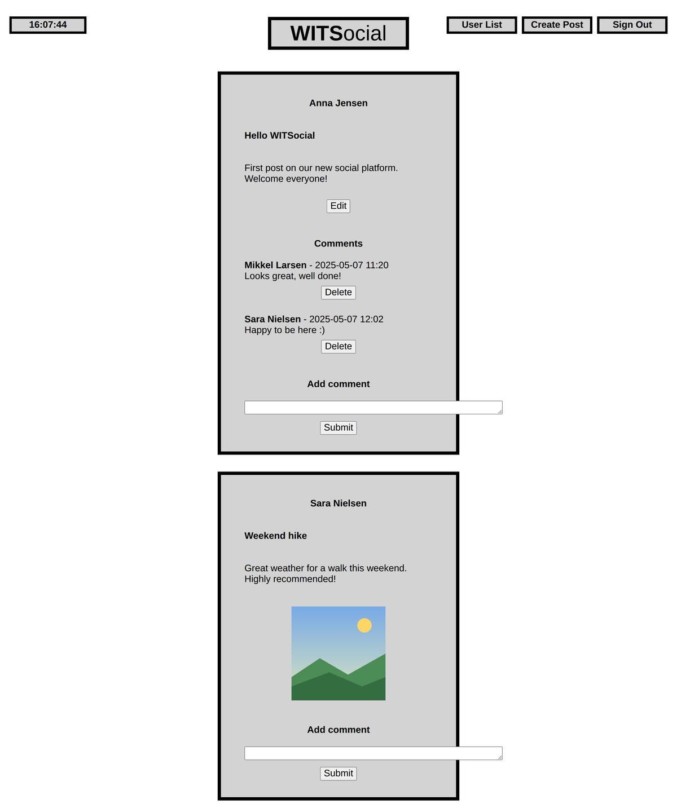
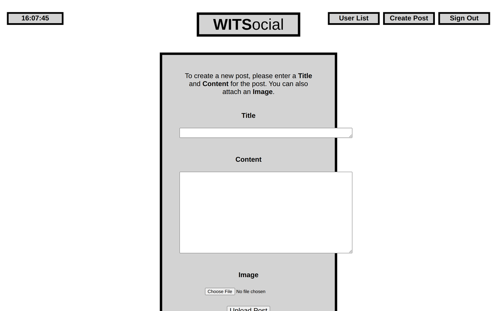
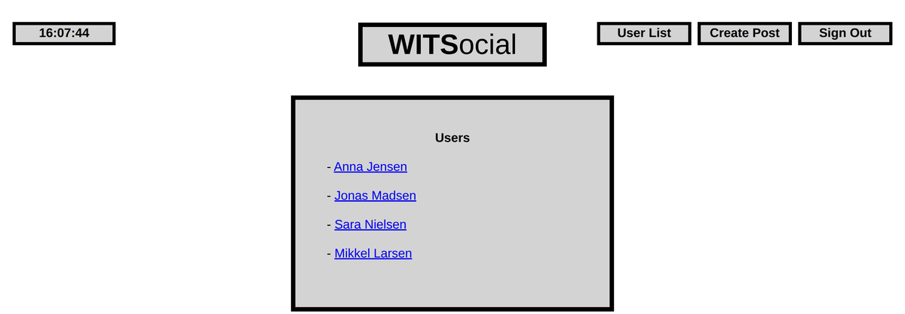

# WITSocial

A small social media platform built with PHP. Users can sign up, log in, write posts with images, edit their own posts, comment, and browse other users' feeds.

> Group project for the Web-Based IT Systems course at Roskilde University (spring 2025), by Mads Degn, Daniel Holst Pedersen, Liva Plougmann Sørensen and Magnus Østergaard.
> Original repository: [madsdegn/WITSocial](https://github.com/madsdegn/WITSocial)

**Tech:** PHP · HTML · CSS · JavaScript

---

## Screenshots

The app uses the course's database API, which only runs on Roskilde University's server. The screenshots below were therefore rendered locally with sample data (the names and posts are made up).

| Feed (logged in) | Create post |
|---|---|
|  |    |

## Features

| Page | What it does |
|---|---|
| `createUser.php` | Sign up with a user ID, name and password (at least 8 characters). |
| `login.php` / `logout.php` | Log in and out. The logged-in user is kept in a PHP session. |
| `feed.php` | Shows every post, newest first, with images and comments. Logged-in users can comment. You can delete comments on your own posts and your own comments. |
| `createPost.php` + `attach.php` | Write a new post and optionally attach an image. |
| `editPost.php` | Edit the title and content of your own posts. |
| `userList.php` / `userFeed.php` | List all users and view the posts of a single user. |

## How it works

Every page is rendered on the server with PHP. Data is read and written through the course API (`db.php` on wits.ruc.dk), with functions such as `get_pids()`, `get_post()`, `add_comment()` and `add_attachment()`. The files were uploaded to the university's web server and accessed through RUC's VPN.

## Running it

The project depends on the course API and cannot run outside Roskilde University's WITS server.

## What I would do differently today

- **Escape all user content.** Post titles, content and comments are printed directly into the HTML, which allows cross-site scripting. Every value should go through `htmlspecialchars()`.
- **Don't keep the password in the session.** Only the user ID should be stored after login.
- **Make the layout responsive.** The header buttons and comment field don't adapt well to narrow screens.

## License

MIT. See [LICENSE](LICENSE).
